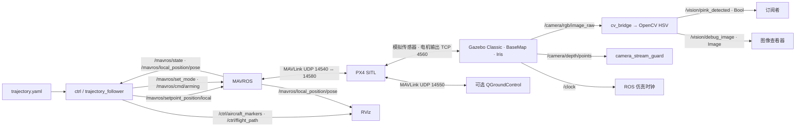

系统架构



目录结构

```text
project1/
├── README.md
├── src/
│   ├── CMakeLists.txt                          Catkin 工作空间入口
│   ├── ctrl/
│   │   ├── CMakeLists.txt / package.xml
│   │   ├── config/trajectory.yaml              航点、频率/超时与安全边界
│   │   ├── config/trajectory.rviz              RViz 显示配置
│   │   ├── launch/trajectory.launch            单独启动航线节点
│   │   ├── launch/visualization.launch         可视化节点 + RViz
│   │   ├── scripts/trajectory_follower.py      20 Hz OFFBOARD 位置控制
│   │   └── scripts/flight_visualizer.py        机体/轨迹 RViz 可视化
│   └── drone_vision/
│       ├── CMakeLists.txt / package.xml
│       ├── config/pink.yaml                    浅粉色 HSV 阈值（BaseMap）
│       ├── config/red.yaml                     红色 HSV 阈值（color_test）
│       ├── launch/basemap_mission.launch       一键入口：仿真 + 视觉 + 航线
│       ├── launch/sitl_rgbd.launch             Gazebo + PX4 + MAVROS + RGB-D
│       ├── launch/color_detection.launch       颜色检测节点入口
│       ├── models/basemap/                     BaseMap 几何、材质、贴图（含粉色立柱）
│       ├── models/iris_rgbd/                   带前向 RGB-D 相机的 Iris
│       ├── worlds/basemap.world                基础场景
│       ├── worlds/color_test.world             颜色检测测试场景
│       ├── scripts/color_detector.py           检测节点
│       ├── scripts/camera_stream_guard.py      点云保活
│       └──  scripts/start_px4.sh                启动已编译的 PX4 SITL
└── vendor/PX4-Autopilot/                       PX4 v1.14.4
```

主要话题、服务与参数

| 名称 | 类型 | 说明 |
|---|---|---|
| `/mavros/state` | `mavros_msgs/State` | 飞控连接、模式、解锁状态 |
| `/mavros/local_position/pose` | `geometry_msgs/PoseStamped` | 本地 ENU 位姿 |
| `/mavros/setpoint_position/local` | `geometry_msgs/PoseStamped` | 位置设定值，20 Hz |
| `/mavros/set_mode` | `mavros_msgs/SetMode` | 请求 OFFBOARD |
| `/mavros/cmd/arming` | `mavros_msgs/CommandBool` | 请求解锁 |
| `/camera/rgb/image_raw` | `sensor_msgs/Image` | 640×480 RGB，约 10 Hz |
| `/camera/depth/image_raw` | `sensor_msgs/Image` | 深度图 |
| `/camera/depth/points` | `sensor_msgs/PointCloud2` | 深度点云 |
| `/vision/pink_detected` | `std_msgs/Bool` | 颜色检测结果 |
| `/vision/debug_image` | `sensor_msgs/Image` | 带框调试图（有订阅者时发布） |
| `/ctrl/aircraft_markers` | `visualization_msgs/MarkerArray` | RViz 四旋翼模型 |
| `/ctrl/flight_path` | `nav_msgs/Path` | RViz 飞行轨迹 |
| `/clock` | `rosgraph_msgs/Clock` | Gazebo 仿真时间 |

快速开始

一键启动： GazeboUI 定点飞行 视觉监测

```bash
cd ~/project1
source devel/setup.bash
roslaunch drone_vision basemap_mission.launch enable_control:=true
```

飞行模式控制

```bash
# 起飞2 m 悬停 5 秒 飞三个航点
roslaunch drone_vision basemap_mission.launch enable_control:=true

# 正方形：边长自定义（这个地图用的是自己建模的26浙江工创赛地图，可以提供BLENDER工程文件，因为地图的障碍物和外墙高度是3m，为了能保证正常飞行把飞行高度升到3.3m）
roslaunch drone_vision basemap_mission.launch enable_control:=true \
  mission:=square square_side:=1.40 #这里传入边长参数

# 越障：飞越粉色立柱
roslaunch drone_vision basemap_mission.launch enable_control:=true mission:=avoid
```
